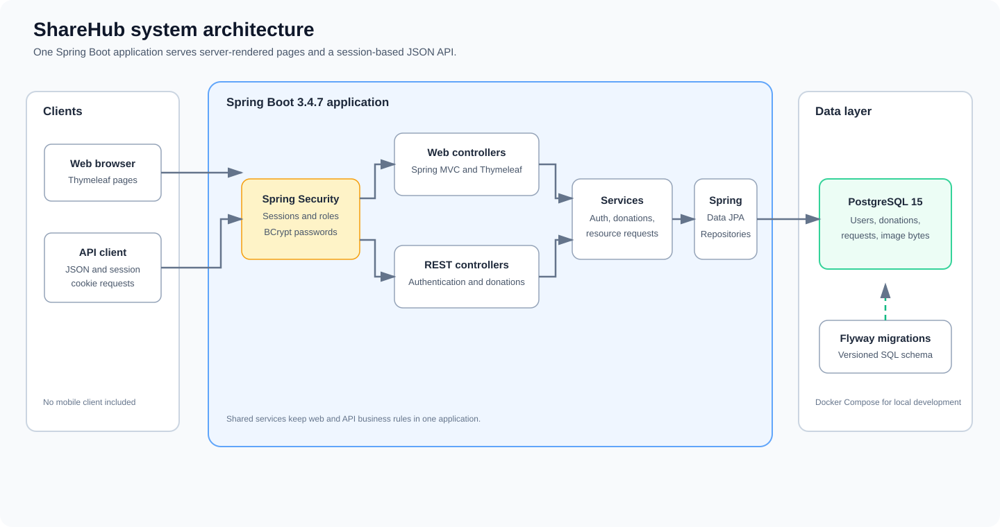
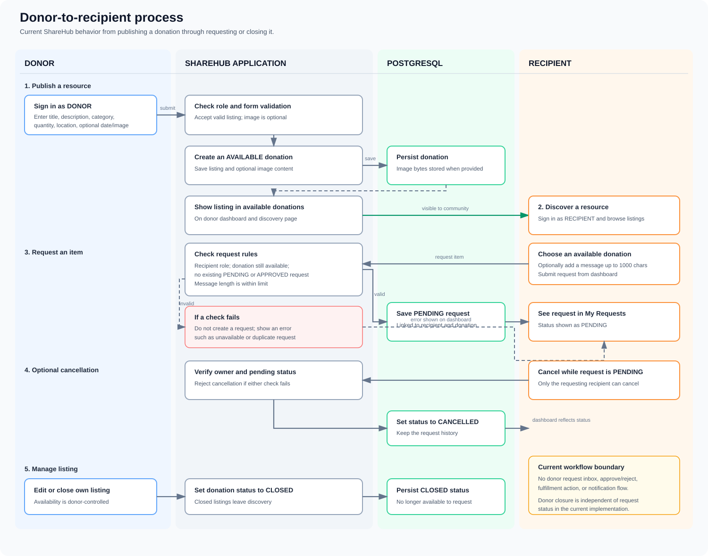

# ShareHub

ShareHub is a community resource-sharing web application. Donors can publish useful items, and recipients can discover available donations and submit or cancel requests. The project is built with Java 17 and Spring Boot and includes both server-rendered web pages and a session-based JSON API.

## System architecture



The diagram shows the current application and data flow. The API can serve external clients, but a separate mobile application is not included in this repository. For the component-level diagram and inventory, see [the architecture notes](.github/modernize/assessment/engines/facts/architecture-diagram.md).

## Donor-to-recipient process



The flow reflects the current implementation: donors publish available listings; recipients can request them and cancel pending requests. Donor review, approval, fulfillment, and request notifications are not currently implemented. See [the business workflow notes](.github/modernize/assessment/engines/facts/business-workflows.md) for the detailed rules and workflow.

## The problem this project addresses

Useful items can be available in a community while people nearby still struggle to find them. ShareHub models a simple way to connect those sides: donors list available food, clothing, books, household goods, or other resources; recipients browse the listings and request items. Donation ownership, availability, and request status are represented in the application rather than coordinated through disconnected posts or messages.

This describes the problem the project is designed to solve; it is not a claim that the application is currently deployed for a live community.

## Features

- Donor and recipient accounts, registration, login, and logout.
- BCrypt password hashing and role-based access controls.
- Session-authenticated Thymeleaf pages and JSON API endpoints.
- Donor donation creation, editing, image upload, availability management, and listing history.
- Recipient donation discovery, request submission, request history, and cancellation of pending requests.
- Optional Gemini-assisted donation drafts and natural-language donation search with local relevance ranking.
- PostgreSQL persistence for users, donations, donation images, and resource requests.
- Flyway-managed SQL migrations and Hibernate schema validation in the default application configuration.
- OpenAPI documentation and Docker Compose development environment.

## Technology

| Area | Technology |
|---|---|
| Language | Java 17 |
| Framework | Spring Boot 3.4.7 |
| Web | Spring MVC, Thymeleaf |
| Security | Spring Security 6, BCrypt, HTTP session cookies |
| Persistence | Spring Data JPA, Hibernate |
| Database | PostgreSQL 15 in Docker Compose |
| Schema changes | Flyway |
| API documentation | springdoc OpenAPI 2.2.0 |
| Build and tests | Maven Wrapper, JUnit and Spring Boot Test |
| Containerization | Multi-stage Docker build, Docker Compose |

## Architecture and data flow

The browser UI and JSON API are two entry points into the same Spring Boot application. Spring Security authenticates requests and applies role-based access rules; controllers use services for application behavior, and services access PostgreSQL through Spring Data repositories. Flyway applies the SQL migrations on application startup. Donation image bytes are stored in PostgreSQL; this project does not currently use a separate object store, cache, message broker, or third-party API.

The application uses cookie-backed sessions, including for JSON API clients; it does not use JWT authentication. Local sessions are not configured with a shared external session store, so a multi-instance deployment would need shared session management.

## Optional AI features

The donation form can use Google Gemini to draft a title, description, and category from donor notes and suggest listing details that may be missing. Recipients can search in natural language from the dashboard or donations page. Gemini interprets the search into keywords and optional category/location hints; ShareHub ranks listings locally and does not send donation listings, account data, or recipient profile data to the AI provider. AI suggestions are editable and are never published automatically.

AI is optional. Without a configured API key, donation browsing uses local keyword matching and the draft assistant returns a configuration message. With AI enabled, only the notes or search text a user submits is sent to Google Gemini. Ask users not to enter private or sensitive information.

Configure these environment variables; never commit API keys:

| Variable | Default | Purpose |
|---|---|---|
| `GEMINI_API_KEY` | unset | Google AI Studio API key; enables Gemini features |
| `GEMINI_MODEL` | `gemini-3.8-flash` | Gemini model ID |
| `GEMINI_FALLBACK_MODEL` | `gemini-3.5-flash-lite` | Secondary Gemini model used when the primary model exhausts retries with HTTP 503; set blank to disable |
| `GEMINI_API_ENDPOINT` | Google Gemini OpenAI-compatible chat completions URL | Optional API endpoint override |

Transient Gemini failures (HTTP 429/5xx and network errors) are retried up to three total attempts. Normal backoff waits at least 2 seconds before attempt 2 and 4–5 seconds before attempt 3. An HTTP 503 immediately routes the next attempt to the configured fallback model without waiting; if that attempt also gets 503, the final retry stays on the fallback model and uses normal backoff.

PowerShell with Docker Compose:

```powershell
$env:GEMINI_API_KEY = "your-google-ai-studio-key"
docker compose up --build
```

PowerShell for local Maven runs:

```powershell
$env:GEMINI_API_KEY = "your-google-ai-studio-key"
.\mvnw.cmd spring-boot:run
```

Natural-language search is also available on `GET /api/donations?search=...`; the donor-only AI draft endpoint is `POST /api/donations/ai/suggest`. The equivalent browser endpoint is `POST /donations/ai/suggest`.

## Routes

### Web

| Route | Access | Purpose |
|---|---|---|
| `/login`, `/register` | Public | Sign-in and registration pages |
| `/dashboard` | Authenticated | Donor listings or recipient discovery and requests |
| `/profile` | Authenticated | Current user's profile |
| `/donations`, `/resources` | Authenticated | Browse available donations |
| `/donations/new` | Donor | Publish a donation |
| `/donations/{id}/edit` | Donor owner | Edit a listing |
| `/recipient/requests` | Recipient | Submit a donation request |
| `/recipient/requests/{requestId}/cancel` | Recipient owner | Cancel a pending request |

### JSON API

Authentication endpoints are under `/api/auth`. Registration and login create a session; clients must retain and send the `SHAREHUB_SESSION` cookie on subsequent requests.

| Method | Endpoint | Access | Purpose |
|---|---|---|---|
| `POST` | `/api/auth/register` | Public | Register and start a session |
| `POST` | `/api/auth/login` | Public | Log in and start a session |
| `POST` | `/api/auth/logout` | Authenticated | Invalidate the session |
| `GET` | `/api/auth/session-info` | Public | Inspect current session state |
| `GET` | `/api/donations` | Authenticated | List available donations |
| `GET` | `/api/donations?search=...` | Authenticated | Search and rank available donations |
| `GET` | `/api/donations/mine` | Authenticated | List donations associated with the current account |
| `POST` | `/api/donations` | Donor | Create a donation |
| `POST` | `/api/donations/ai/suggest` | Donor | Suggest an editable donation draft from notes |
| `POST` | `/api/donations/{id}/close` | Donor owner | Close a donation |
| `GET` | `/api/dashboard` | Authenticated | Return the current authentication details |

Donation categories are `FOOD`, `CLOTHING`, `BOOKS`, `HOUSEHOLD`, and `OTHER`. The web UI supports image uploads (JPEG, PNG, or WebP, up to 5 MB); images are stored in the database. Resource-request management currently has web routes, not a separate JSON API.

Swagger UI is available at <http://localhost:8080/swagger-ui/index.html>.

## Run with Docker Compose

Docker Compose starts PostgreSQL and builds/runs the application. Docker Compose is the simplest local setup:

```bash
docker compose up --build
```

Open <http://localhost:8080>. Stop the services with:

```bash
docker compose down
```

The database data is kept in the `postgres_data` named volume. To remove that local data as well:

```bash
docker compose down -v
```

**Local development only:** the Compose file contains default database credentials and overrides Hibernate's schema mode to `update`. Do not reuse those credentials in production. In the default `application.properties` configuration, Hibernate validates the schema (`validate`) and Flyway applies migrations.

## Run locally without Docker

Requirements: JDK 17 or newer, Maven Wrapper (included), and a PostgreSQL database.

Create a database named `sharehub`. Configure the database through `DB_HOST`, `DB_PORT`, `DB_NAME`, `DB_USERNAME`, and `DB_PASSWORD`; the default host, port, database, and username are `localhost`, `5432`, `sharehub`, and `postgres`. Set `DB_PASSWORD` to the password for your local database.

Windows PowerShell:

```powershell
$env:DB_PASSWORD = "your-local-database-password"
.\mvnw.cmd spring-boot:run
```

macOS/Linux:

```bash
export DB_PASSWORD=your-local-database-password
./mvnw spring-boot:run
```

The server uses `PORT` when set and otherwise listens on port `8080`. `SESSION_COOKIE_SECURE` defaults to `false` for local HTTP; set it to `true` when serving the application over HTTPS.

## Database migrations

Flyway migrations are in `src/main/resources/db/migration`:

- `V1`: users
- `V2`: donations
- `V3`: resource requests
- `V4`: donation images

When running with the default application configuration, Flyway manages schema changes and Hibernate validates the resulting schema at startup.

## Build and tests

Build the application without running tests:

```bash
./mvnw package -DskipTests
```

Windows:

```powershell
.\mvnw.cmd package -DskipTests
```

Run the test suite:

```bash
./mvnw test
```

Windows:

```powershell
.\mvnw.cmd test
```

The repository includes service tests for donation and resource-request behavior. The Spring application-context test connects to PostgreSQL and runs Flyway, so a reachable database with matching configuration is required for the full test suite.

## Production engineering lessons from this project

Building ShareHub has given me practical experience with production-oriented concerns:

- **Configuration by environment:** database connection values and the server port can be supplied by the deployment environment instead of being tied to one machine.
- **Database change management:** versioned Flyway migrations provide an auditable schema history; Hibernate schema validation can catch a mismatch at startup.
- **Authentication and authorization:** BCrypt password hashing, session-cookie settings, and donor/recipient permissions protect account and listing workflows.
- **Containerized delivery:** a multi-stage Dockerfile separates the Java build image from the smaller runtime image; Compose coordinates the app and database and waits for PostgreSQL's health check.
- **Operational data and startup behavior:** a named database volume preserves local data across container restarts, while database availability and credentials are essential to application startup.
- **Testing behavior, not just compilation:** service tests cover core donation and request rules, and the database-backed context test exercises Flyway and application wiring.
- **Deployment trade-offs:** secure cookies need HTTPS, local Compose credentials must be replaced, and running multiple app instances requires shared session storage and operational setup such as monitoring and database backups.

This project is a learning and portfolio project, not a claim of a fully production-hardened service. The lessons above reflect concrete implementation choices and deployment gaps identified while building it.

## Project layout

```text
src/main/java/com/sharehub/sharehub/
  config/       Spring Security configuration
  controller/   Web and REST controllers
  dto/          API request and response objects
  entity/       JPA entities
  exception/    REST error handling
  repository/   Spring Data repositories
  service/      Authentication, donation, and request logic

src/main/resources/
  db/migration/ Flyway SQL migrations
  static/       CSS and JavaScript
  templates/    Thymeleaf pages and fragments
```

## License

No license has been added to this repository yet.
//two unused fs-991 calculator,available for pick up in Dhanmondi.